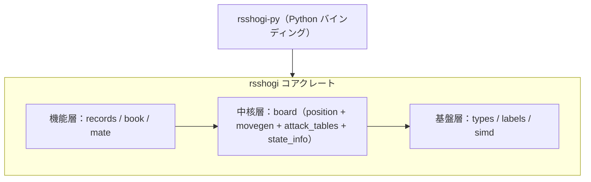

# 全体アーキテクチャ

`rsshogi` は、将棋の盤面表現や合法手生成を担うコアクレート `rsshogi` と、PyO3 による薄い Python バインディング `rsshogi-py` で構成される Cargo workspace である。

## ワークスペース構成

| クレート | パス | 配布先 | 役割 |
|---|---|---|---|
| `rsshogi` | `crates/rsshogi/` | crates.io (`rsshogi`) | 盤面表現、合法手生成、1 手詰め判定、棋譜や定跡の入出力を担う Rust コアライブラリ。 |
| `rsshogi-py` | `crates/rsshogi-py/` | PyPI (`rsshogi` / `rsshogi-avx2`) | コアクレートの機能を Python へ公開する PyO3 バインディング。 |

Python パッケージは汎用ビルドの `rsshogi` と AVX2 最適化ビルドの `rsshogi-avx2` の 2 系統で配布されるが、どちらも Python 上の import 名は `rsshogi` で共通である。

## コアクレートのモジュール階層

`rsshogi` コアクレートは、役割に応じて 3 つの層に分かれている。
下位の層は上位の層に依存しない単方向の依存関係を持つ。



```text
crates/rsshogi/src/
├── types/          基本型（Color, File, Rank, Square, PieceType, Piece, Hand, Move, Move32, Bitboard）
├── labels/         指し手と Policy ラベル（2187 / 1496 次元）の算術変換 [feature = "policy-labels"]
├── simd/           クレート内部の 128-bit / 256-bit ベクトル演算プリミティブ
├── board/          局面管理、利き計算、合法手生成
│   ├── position/       Position 本体、指し手適用と復元、合法性判定、Zobrist ハッシュ、256-bit 圧縮、SVG
│   ├── movegen/        駒種別の指し手生成（盤上移動、駒打ち、王手回避、王手生成、段階生成）
│   ├── attack_tables.rs 近接利きテーブルと飛び利き計算（build.rs 生成テーブルを利用）
│   ├── bitboard_set.rs 駒種別、手番別、および 6 種の複合キャッシュビットボード
│   ├── state_info.rs   StateStack（64 要素チャンク）と StateHot / StateColdPayload
│   ├── zobrist.rs      Zobrist 乱数テーブルと ZobristKey（64-bit / 128-bit）
│   ├── lookup.rs       2 マス間の幾何テーブル（BETWEEN / LINE / is_aligned）
│   ├── move_list.rs    ヒープ確保を行わない固定容量の指し手コンテナ（MoveList / Move32List）
│   └── perft.rs        合法手生成の網羅性テストと性能計測用 perft
├── mate.rs         静的反駁フィルタを備えた 1 手詰めソルバ
├── book/           定跡の参照、変換、構築（NativeBook, NativeBookEditor, DB2016, YBB, SBK, BookDatabase）[feature = "book"]
└── records/        棋譜と教師データの入出力（KIF, KI2, CSA, JKF, PACK, SBINPACK, SAZPACK, HCPE）[feature = "records"]
```

- **基盤層（`types`、`labels`、`simd`）**：盤面の状態を持たないプリミティブ型と定数演算を提供する。`labels` は `Move` と手番だけから Policy ラベルを計算するため、局面表現やファイル形式に依存しない。
- **中核層（`board`）**：`Position` と `StateStack` による局面の差分更新、`AttackTables` による利き計算、`movegen` による合法手生成を統合する。
- **機能層（`mate`、`book`、`records`）**：中核層の API の上に構築される。`mate` は常時有効であり、`book` と `records` は対応する Cargo feature で有効化する。

## Cargo Feature フラグ一覧

`rsshogi` のデフォルト設定は `default = []` である。
USI 探索エンジンのように盤面操作と合法手生成だけを必要とする利用側では、`serde` や `encoding_rs` などの外部クレートを一切コンパイルせずに最小構成でビルドできる。

| Feature 名 | 暗黙に有効化する Feature / 外部依存 | 有効になる主な機能とモジュール |
|---|---|---|
| （デフォルト：指定なし） | `thiserror`, `log` のみ | `types`、`board`（`Position`、`movegen`、`perft`、SFEN 入出力）、`mate`（1 手詰め判定）。 |
| `hash-128` | なし | `ZobristKey` を `u64` から `u128` へ拡張する。下位 64 bit の値は 64-bit ビルドと完全に一致する。 |
| `policy-labels` | なし | `rsshogi::labels::policy` モジュール（2187 ラベルと 1496 コンパクトラベルの変換）。 |
| `position-serialization` | なし | `Position` の `PackedSfen`、`HuffmanCodedPos`（HCP）、`PackedSfenValue`（PSV）変換とビットストリーム I/O。 |
| `svg` | なし | `Position::to_svg` および `SvgOptions` による盤面の SVG 文字列出力。 |
| `validation` | なし | `Position::validate`、`validate_all`、`is_valid` による局面の整合性検証メソッド。 |
| `initial-positions` | なし | `board::InitialPosition` 列挙型（平手および駒落ち 14 種の SFEN と手合割名の相互変換）。 |
| `book` | `initial-positions`, `position-serialization` | `rsshogi::book` モジュール（`NativeBook`、`NativeBookEditor`、`YaneuraOuBook`、`YbbBook`、`SbkBook`、`BookDatabase`）。`NativeBookBuilder` は順次入力から本体を構築する。 |
| `records` | `position-serialization`, `initial-positions`, `policy-labels`, `encoding_rs`, `serde`, `serde_json`, `ordered-float` | `rsshogi::records` モジュール（`Record`、KIF / KI2 / CSA / JKF、PACK、SBINPACK、SAZPACK、HCPE の入出力）。 |
| `python-data` | `book`, `records`, `position-serialization`, `svg`, `validation` | `rsshogi-py` が使用するデータ処理系 Feature 一式をまとめて有効化する。 |

## 責務境界と設計原則

`rsshogi` は「将棋のルール、局面状態、データ形式を正確に扱う基盤ライブラリ」に徹しており、探索エンジン固有のポリシーとは明確に境界を引いている。

1. **探索アルゴリズムと評価関数を本体に含めない**：置換表（Transposition Table）、NNUE 評価関数、オーダリング用の History テーブル、並列探索（Lazy SMP）、持ち時間制御、定跡の確率的選択ロジックは利用側のエンジン層に委ねる。代わりに、`StateCacheView` による戦術キャッシュの参照、`MoveApplyFacts` による指し手適用結果の取得、`clone_for_search()` による独立した探索用コピーなど、探索エンジンが必要とする低レベルプリミティブを提供する。着手前のキー予測や TT prefetch は、consumer が自身の探索状態を使って実装する。
2. **設定は呼び出し箇所ごとに指定する**：不成（成れるのに成らない手）を含むかどうかといった手生成方針は、グローバルなフラグではなく `Legal` / `LegalAll` や `Evasions` / `EvasionsAll` などの型パラメータと関数で呼び出し箇所ごとに明示する。これにより、同一プロセス内で探索部（`Legal`）と棋譜解析部（`LegalAll`）が干渉せずに共存できる。 互換性のために残す例外として、`Position::set_max_repetition_ply()` はプロセス全体の `clone_for_search()` の履歴保持上限を変更する。この API は 1.6.0 から非推奨で、2.0.0 で削除予定である。
3. **ホットパスでのヒープ確保を排除する**：合法手リスト `MoveList` / `Move32List` は `MaybeUninit` を用いた固定長のスタック配列で実装し、局面履歴 `StateStack` は 64 局面単位のチャンク配列で管理することで、探索中のメモリアロケーションとポインタ移動を防ぐ。
4. **公開 raw 値とワイヤ形式の互換性を固定する**：`Square`（`0..=80`、`SQ_NONE = 81`）、`Hand(u32)`、`Move(u16)`（やねうら王互換ビット配置）、`AperyMove(u16)`（cshogi / Apery 互換ビット配置）、Zobrist キー、および HCP / PackedSfen / SBINPACK / SAZPACK のバイナリレイアウトは契約テストで固定し、外部ツールや学習データとの相互運用性を保証する。

各モジュールのデータ構造とアルゴリズムの詳細は [内部設計とアルゴリズム](internals/index.md) を、Rust の公開 API 仕様は [docs.rs](https://docs.rs/rsshogi) を参照。
