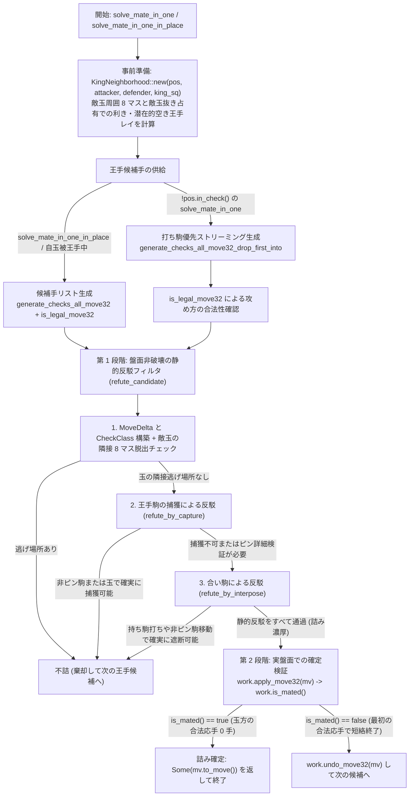

# 1 手詰めソルバ（Mate-in-One）

1 手詰めソルバ（`crates/rsshogi/src/mate.rs`）は、現在の局面において「手番側が 1 手で相手玉を詰ませる合法手（王手）」が存在するかを高速に判定し、存在する場合はその `Move` を返すモジュールである。
探索エンジンの各ノードで葉ノード展開の前に呼び出されるため、`rsshogi` では **盤面を一切更新しないビットボード上の静的反駁フィルタ（Static Refutation Filter）** によって大半の不詰王手を数クロックで棄却し、静的反駁を生き残った極少数の候補手にだけ実盤面での完全検証（`is_mated()`）を適用する二段構えのアーキテクチャを採用している。

---

## 全体パイプラインと 2 つの実行経路

1 手詰めソルバには、不変参照 `&Position` を受け取る `solve_mate_in_one` と、可変参照 `&mut Position` を受け取る `solve_mate_in_one_in_place` の 2 つのエントリポイントがある。

### 経路 1：打ち駒優先ストリーミングと遅延クローン（`!in_check` の `solve_mate_in_one`）

自玉に王手がかかっていない通常の局面で `solve_mate_in_one(&pos)` が呼ばれた場合、最初から作業用の `Position` をクローンしたり全王手リストを配列に書き出したりはしない。

1. まず `KingNeighborhood::new` で敵玉周辺のビットボード情報を構築する。
2. `generate_checks_all_move32_drop_first_into` を用いて、**持ち駒を打つ王手から順番に** 1 手ずつストリーム供給する。実戦の 1 手詰めは頭金や腹銀などの「駒打ち王手」で決まる割合が非常に高いため、盤上移動の王手を生成する前に詰みを発見して早期リターンできる確率が劇的に高まる。
3. 各王手候補に対して盤面非破壊の `refute_candidate`（静的反駁）を実行する。もし全局面の王手がすべて静的反駁で棄却されれば、**`Position` のクローンも `apply_move32` も 1 回も実行されることなく** `None` が返る。
4. 静的反駁を生き残った最初の候補手が現れた時点で初めて内部 API の `pos.clone_for_search_bounded(16)` で作業局面を遅延生成（`lazy_work.get_or_insert_with(...)`）し、`work.apply_move32(mv)` と `work.is_mated()` を呼ぶ。

### 経路 2：リスト生成と In-Place 検証（`solve_mate_in_one_in_place`）

呼び出し側がすでに `&mut Position` を持っている `solve_mate_in_one_in_place`（および自玉に王手がかかっており逆王手での 1 手詰めを探すケース）では、`prepare_mate_candidates` で合法な王手リストを抽出し、静的反駁を生き残った手に対して同じ `pos` 上で直接 `apply_move32` → `is_mated()` → `undo_move32` を実行する。

---

## 第 1 段階：盤面非破壊の静的反駁フィルタ（`refute_candidate`）

静的反駁の目的は、「玉方に **確実に合法な逃れ手（玉の脱出、王手駒の捕獲、または合い駒）が最低 1 つ存在する** こと」をビットボード演算だけで証明し、重い `apply_move32` + `is_mated()` の呼び出しをスキップすることである。
健全性（Soundness：本当の詰み手を誤って棄却しないこと）を 100% 保証するため、ピンの判定などでは **保守的な過大近似（少しでもピンの疑いがある玉方駒は「確実に動ける」とはみなさず、第 2 段階の実盤面検証へ回す）** を行っている。

### 1. `KingNeighborhood` による敵玉周辺の事前計算

ループに入る前に、現局面の敵玉 `king_sq` に関して以下の情報を 1 回だけ計算して `KingNeighborhood` に保持する。

- **`occupied_without_king`**：敵玉自身のビットを消去した占有ビットボード。王手を受けた敵玉が飛び駒のレイと同じ方向へ後退して逃げる際、元の玉自身が自分の影になって安全だと誤認するのを防ぐために必須となる。
- **`king_removed_attackers`**：`occupied_without_king` 上で敵玉の周囲 8 マスそれぞれに利いている攻め方駒のビットボード配列 `[Bitboard; 8]`。
- **`potential_discovered_attackers` と 4 方向レイ**：敵玉から伸びる香、飛（縦と横）、角のレイと、その方向にある攻め方の飛び駒。攻め方の駒が動いたときにどの方向の空き王手や利き延長が発生し得るかをマスク判定するために用いる。

### 2. `MoveDelta` と `attackers_with_delta` による移動後の仮想利き計算

各王手候補 `mv` に対し、`Position` を書き換える代わりに移動前後の差分情報を表す `MoveDelta` をスタック上で構築する。

- **駒打ちのとき**：`from_sq = None`、`to_sq`、`placed_pt`、および `occupied_after = occupied | to_sq`、`occupied_without_king_after = occupied_without_king | to_sq`。
- **盤上移動のとき**：`from_sq = Some(from)`、`to_sq`、`placed_pt`（成り後の駒種）、および `from` のビットを消して `to` のビットを立てた `occupied_after`。

`attackers_with_delta` は、事前計算済みの `KingNeighborhood` に対して「`from_sq` から消えた駒の利きを除外し、`to_sq` に置かれた駒の新たな利きを追加し、`from_sq` や `to_sq` が飛び駒のレイ上にある場合のみそのレイ方向の飛び駒利きを再計算する」ことで、移動後の盤面における任意のマスへの攻め方の利きを数命令で算出する。

### 3. 王手の分類（`CheckClass`）と玉の隣接脱出判定

`classify_check_and_filter_king_escapes` は、王手候補 `mv` を以下の 3 種類に分類すると同時に、敵玉の周囲 8 マスへの脱出可能性を検査する。

- `CheckClass::Direct { checker_sq: to_sq }`：打った駒または移動した駒自身のみによる単王手。
- `CheckClass::Discovered { checker_sq }`：移動元 `from_sq` が空いたことで背後の飛び駒 `checker_sq` が敵玉を射抜く空き王手（単王手）。
- `CheckClass::Double`：移動した駒自身と背後の飛び駒の双方が同時に敵玉を射抜く両王手。

同時に、敵玉の周囲 8 マスのうち「玉方の味方駒がないマス（または `to_sq` で攻め方駒を取れるマス）」を走査し、移動後の仮想盤面で攻め方の利きが 1 枚も届いていないマスが **1 つでも見つかれば**、敵玉はそのマスへ合法に逃げられるため即座に反駁成立（`true` を返して候補棄却）となる。

### 4. 王手駒の捕獲による反駁（`refute_by_capture`）

敵玉に隣接マスへの逃げ場がない場合、次に「王手をかけている駒 `checker_sq` を玉方の駒で捕獲できるか」を検査する（`CheckClass::Double` の両王手では玉以外の駒による捕獲では解決しないためスキップされる）。

- **玉以外の玉方駒による捕獲**：`checker_sq` に利いている玉方の駒（玉を除く）を取り出し、`surely_legal_defender_move` で「その駒が移動後の盤面でも確実にピンされていないか」を検査する。
  具体的には、元の `blockers_for_king(defender)` と、攻め方の移動によって新たに発生し得るピン候補の和集合 `pinned_mask` に含まれていないか、あるいは含まれていても移動方向が玉との直線（`Bitboard::is_aligned(from, checker_sq, king_sq)`）に沿っていれば、100% 合法に王手駒を捕獲できるため反駁成立となる。
- **敵玉自身による捕獲**：`checker_sq` が敵玉の周囲 8 マスにあり、かつ移動後の仮想盤面で `checker_sq` に攻め方の紐（他の攻め方駒の利き）がついていなければ、敵玉自身で王手駒を取れるため反駁成立となる。

### 5. 合い駒による反駁（`refute_by_interpose`）

`checker_sq` が飛び駒による遠隔単王手であり、玉と王手駒の間のマス `between = Bitboard::between(king_sq, checker_sq)` が空でない場合、その間のマス `interpose_sq` への合い駒による反駁を検査する。

- **持ち駒による打つ合い**：玉方が歩以外の持ち駒（香、桂、銀、金、角、飛）のどれか 1 枚でも持っていれば、行き所のない段でない限り `between` 上に必ず合法に打てるため即座に反駁成立となる。歩しか持っていない場合も、`interpose_sq` が一段目でなく、かつその筋に玉方の歩がなければ（二歩でなければ）歩合いで確実に遮断できるため反駁成立となる（打つ合いは自玉に対する合駒であるため、打ち歩詰めになることは構造上あり得ない）。
- **盤上駒による移動合い**：`interpose_sq` に利いている玉方の盤上駒（玉を除く）のうち、`surely_legal_defender_move`（ピン安全性）を満たす駒が 1 枚でもあれば移動合いで遮断できるため反駁成立となる。

---

## 第 2 段階：`work.is_mated()` による確定検証

上記の静的反駁フィルタをすべて通過した王手候補 `mv` は、高い確率で本当の 1 手詰めである（または、玉方の捕獲駒に複雑なピンが絡んでいて静的フィルタが保守的に保留したケースである）。

ここで初めて作業用局面 `work` に対して `work.apply_move32(mv)` を実行し、**`work.is_mated()`** を呼び出す。
`Position::is_mated(&self)` は、`LegalAll` の全リストを生成するのではなく、ストリーミング関数 `generate_legal_all_into` を用いて **玉方の合法な応手が最初の 1 手見つかった瞬間に `ControlFlow::Break(())` で生成を打ち切って `false` を返す**。
1 手も合法な応手が存在せず `is_mated() == true` が返った時点で、その王手 `mv` が 1 手詰めの解（`Some(mv.to_move())`）として確定する。
