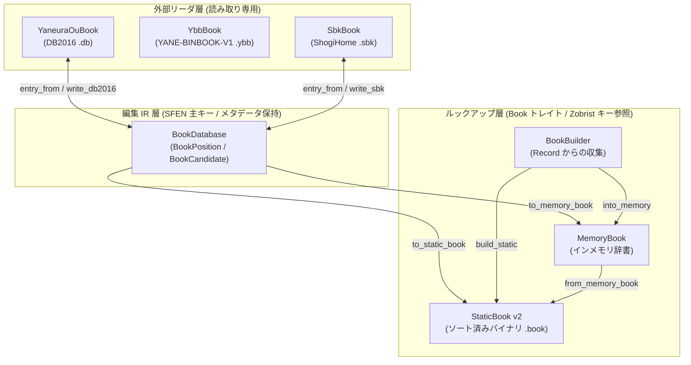

# 定跡 3 層アーキテクチャ

`rsshogi` の定跡（Opening Book）サブシステムは、探索中の高速な候補手参照、外部フォーマットの無損失（lossless）読み取り、および形式間の編集と相互変換という異なる要件を両立するため、3 層アーキテクチャを採用している。

## 1. 3 層構造の全体像

### ルックアップ層（`MemoryBook` / `StaticBook` / `BookBuilder`）

`Book` トレイトを実装し、探索エンジンが対局中に最小のオーバーヘッドで候補手を引くための正規化済み参照層である。

- **局面キー**：`book_key_from_position(&pos)` が返す `BookKey`（盤面、持ち駒、手番から計算される Zobrist ハッシュ。通常は 64-bit、`hash-128` feature 有効時は 128-bit）を主キーとする。手数（ply）はキーに含めない。
- **候補手データ**：1 手あたり `BookMove { mv: Move, score: i16, depth: u16 }`（6 バイト相当）のみを保持する不可逆（lossy）な軽量表現である。
- **`MemoryBook`**：`HashMap<BookKey, Vec<BookMove>>` によるインメモリ辞書であり、動的な候補手追加に対応する。
- **`StaticBook`**：ソート済み `BookKey` 配列とオフセット配列を持つ不変構造であり、`.book` バイナリファイルとの高速な直列化と二分探索を提供する。
- **`BookBuilder`**：`Record`（本手順および変化手順）を DFS 走査して各局面の指し手、評価値、深さを収集し、`MemoryBook` またはソート済み `StaticBook` を構築する。

### 外部リーダ層（`YaneuraOuBook` / `YbbBook` / `SbkBook`）

YaneuraOu や ShogiHome（ShogiGUI）で使われる定跡ファイルを、フォーマット固有のメタデータを落とさずに直接読み取る読み取り専用リーダ群である。

- **`YaneuraOuBook`**：`#YANEURAOU-DB2016 1.00` 形式のテキスト定跡（`.db`）をストリーミングまたは二分探索で参照し、`YaneuraOuBookEntry` / `YaneuraOuBookMove`（`mv`, `ponder`, `score`, `depth`, `count`, `comment`, `min_ply`）を返す。
- **`YbbBook`**：`YANE-BINBOOK-V1` 形式の固定長バイナリ定跡（`.ybb`）を検証してメモリ上に保持し、32 バイトの `PackedSfen` 二分探索によって `YbbEntry` / `YbbMove`（`mv`, `raw_move`, `eval`, `depth`, `ply`, `flipped`）を返す。
- **`SbkBook`**：ShogiHome / ShogiGUI の Protobuf 形式定跡（`.sbk`）を開いて `PackedSfen` と `state_id` のインデックスを構築し、一致した局面の `SbkEntry` / `SbkMove` / `SbkEval` をオンデマンドでデコードする。

### 編集 IR 層（`BookDatabase`）

外部フォーマット間の相互変換や定跡編集を担う所有権付き中間表現（IR）である。

- **局面表現（`BookPosition`）**：手数を `1` に揃えた正規化 SFEN を主キーとし、派生した `BookKey`、32 バイト `PackedSfen`、および元の手数 `original_ply` を併せて保持する。
- **候補手表現（`BookCandidate`）**：`mv: Move`、`ponder: Option<Move>`、`score: Option<i32>`、`depth: Option<u32>`、`weight: Option<i32>`、`count: Option<u64>`、および DB2016 / SBK 由来の詳細メタデータ（`BookMoveMetadata`）を保持する。
- **出力機能**：`to_memory_book` / `to_static_book` によるルックアップ層への射影に加え、`write_yaneuraou_db2016`（DB2016 書き出し）および `write_sbk` / `to_sbk_bytes`（SBK 全体書き出し）を提供する。

## 2. 定跡 4 フォーマットの比較

| 項目 | [StaticBook v2](book.md) | [YaneuraOu DB2016](yaneuraou.md) | [YaneuraOu YBB](yaneuraou.md) | [ShogiHome SBK](sbk.md) |
| :--- | :--- | :--- | :--- | :--- |
| ファイル形式 | 固定長バイナリ（`.book`） | UTF-8 テキスト（`.db`） | 固定長バイナリ（`.ybb`） | Protobuf バイナリ（`.sbk`） |
| ヘッダ / マジック | `RSHOGIBK` + `version = 2` (22B) | `#YANEURAOU-DB2016 1.00` | `YANE-BINBOOK-V1\0` (32B) | `SBook` Protobuf メッセージ |
| 局面キー | `BookKey`（64/128-bit Zobrist） | 正規化 SFEN（手数 `1`） | 32B `PackedSfen` + `ply: u16` | SFEN + `PackedSfen` 索引 + `state_id` |
| 候補手の型 | `BookMove` (6B) | `YaneuraOuBookMove` | `YbbMove` (4B または 6B) | `SbkMove` + `SbkEval` |
| 予想応手（ponder） | ✕ | `ponder: Move`（`none` 可） | ✕ | ✕（`SbkEval.variation` に読み筋） |
| 評価値 | `score: i16` | `score: Option<i32>` | `eval: i16` | `SbkEval.evaluation_value: Option<i32>` |
| 探索深さ | `depth: u16` | `depth: Option<u32>` | `depth: Option<u16>` | `SbkEval.depth: Option<i32>` |
| 採択回数 / 重み | ✕（`score` へ射影可） | `count: Option<u64>` | ✕ | `weight: Option<i32>` / `games: Option<i32>` |
| コメント保持 | ✕ | ○（局面および指し手） | ✕ | ○（author, description, 局面） |
| 書き出し対応 | `StaticBook::write_file` | `BookDatabase::write_yaneuraou_db2016` | ✕（読み取り専用） | `BookDatabase::write_sbk` |

## 3. スコア、深さ、重みのマッピングと丸め規則

外部フォーマット（DB2016 / SBK）と `BookDatabase`、および `StaticBook` / `MemoryBook` の間で変換を行う際のフィールド対応と数値丸め（narrowing）規則は以下の通りである。

### 外部リーダから `BookDatabase` への取り込み

| フィールド | DB2016 (`entry_from_yaneuraou`) | SBK (`entry_from_sbk`) |
| :--- | :--- | :--- |
| `BookCandidate.mv` | `YaneuraOuBookMove.mv`（通常手のみ受理。`resign` 等はエラー） | `SbkMove.mv` |
| `BookCandidate.ponder` | `ponder` が通常手なら `Some(ponder)`、`Move::NONE` 等は `None` | `None` |
| `BookCandidate.score` | `YaneuraOuBookMove.score` (`Option<i32>`) | `None`（状態単位の評価値は `SbkEntryMetadata.evals` に保持） |
| `BookCandidate.depth` | `YaneuraOuBookMove.depth` (`Option<u32>`) | `None`（状態単位の深さは `SbkEntryMetadata.evals` に保持） |
| `BookCandidate.weight` | `None` | `SbkMove.weight` (`Option<i32>`) |
| `BookCandidate.count` | `YaneuraOuBookMove.count` (`Option<u64>`) | `None` |

### `BookDatabase` から `MemoryBook` / `StaticBook` への射影

`BookDatabase::to_memory_book(&options)` および `to_static_book(&options)` では、`NativeBookConvertOptions` に従って各 `BookCandidate` を `BookMove { mv: Move, score: i16, depth: u16 }` へ変換する。

| `BookMove` フィールド | 変換規則 |
| :--- | :--- |
| `mv: Move` | `BookCandidate.mv` をそのままコピーする。 |
| `score: i16` | `NativeScorePolicy::Score`（既定）のときは `candidate.score` を参照し、`NativeScorePolicy::Weight` のときは `candidate.weight` を参照する。値 `Some(v)`（`i32`）が存在する場合は `[i16::MIN, i16::MAX]`（`-32768..=32767`）にクランプし、`None` の場合は `options.missing_score`（既定値 `0`）を使用する。 |
| `depth: u16` | `candidate.depth`（`Option<u32>`）が `Some(d)` の場合は `[0, u16::MAX]`（`0..=65535`）にクランプし、`None` の場合は `options.missing_depth`（既定値 `0`）を使用する。 |

この変換では、`BookDatabase` 内のエントリ順および候補手順がそのまま保持される。
異なる SFEN エントリが同一の `BookKey` に解決された場合は、データベース順で候補手が追記される。

## 4. Rust と Python の API 対応表

| 型 / 関数 | Rust (`rsshogi::book`) | Python (`rsshogi`) | 説明 |
| :--- | :--- | :--- | :--- |
| `BookKey`, `BookMove`, `BookEntry` | ○ | ○ | ルックアップ層のキー、候補手、局面エントリ。 |
| `book_key_from_position`, `book_key_after` | ○ | ○ | `Board` / `Position` からの `BookKey` 計算関数。 |
| `MemoryBook` | ○ | ○ | インメモリ定跡辞書。 |
| `StaticBook` | ○ | ○ | `.book` バイナリの読み書きと二分探索。 |
| `BookBuilder` | ○ | ○ | `Record` や候補手挿入からの定跡構築ビルダー。 |
| `YaneuraOuBook`, `YaneuraOuBookEntry`, `YaneuraOuBookMove`, `YaneuraOuBookDiagnostics` | ○ | ○ | DB2016（`.db`）テキスト定跡のオンデマンドリーダと診断結果。 |
| `SbkBook`, `SbkEntry`, `SbkMove`, `SbkEval`, `SbkDiagnostics`, `SbkOpenProgress` | ○ | ○ | ShogiHome（`.sbk`）Protobuf 定跡のリーダと状態グラフ遷移。 |
| `YbbBook`, `YbbBookOpenOptions`, `YbbEntry`, `YbbMove` | ○ | ✕（Rust のみ） | YaneuraOu `YANE-BINBOOK-V1`（`.ybb`）バイナリ定跡リーダ。 |
| `BookDatabase`, `BookDatabaseEntry`, `BookPosition`, `BookCandidate` | ○ | ✕（Rust のみ） | 定跡編集およびフォーマット間相互変換用の中間表現（IR）。 |
| `NativeBookConvertOptions`, `NativeScorePolicy` | ○ | ✕（Rust のみ） | `BookDatabase` から `MemoryBook` / `StaticBook` への変換オプション。 |
| `YaneuraOuBookOpenOptions`, `YaneuraOuAccessMode` | ○ | ✕（Rust のみ） | DB2016 オープン時のソート検証とアクセスモード指定。 |
| `YaneuraOuDb2016WriteOptions` | ○ | ✕（Rust のみ） | `BookDatabase` からの DB2016 書き出しオプション。 |
| `SbkWriteOptions` | ○ | ✕（Rust のみ） | `BookDatabase` からの SBK 書き出しオプション。 |

## 関連項目

- [StaticBook バイナリフォーマット仕様](book.md)
- [YaneuraOu 定跡フォーマット仕様（DB2016 / YBB）](yaneuraou.md)
- [ShogiHome SBK フォーマット仕様](sbk.md)
- [フォーマット仕様一覧](index.md)
