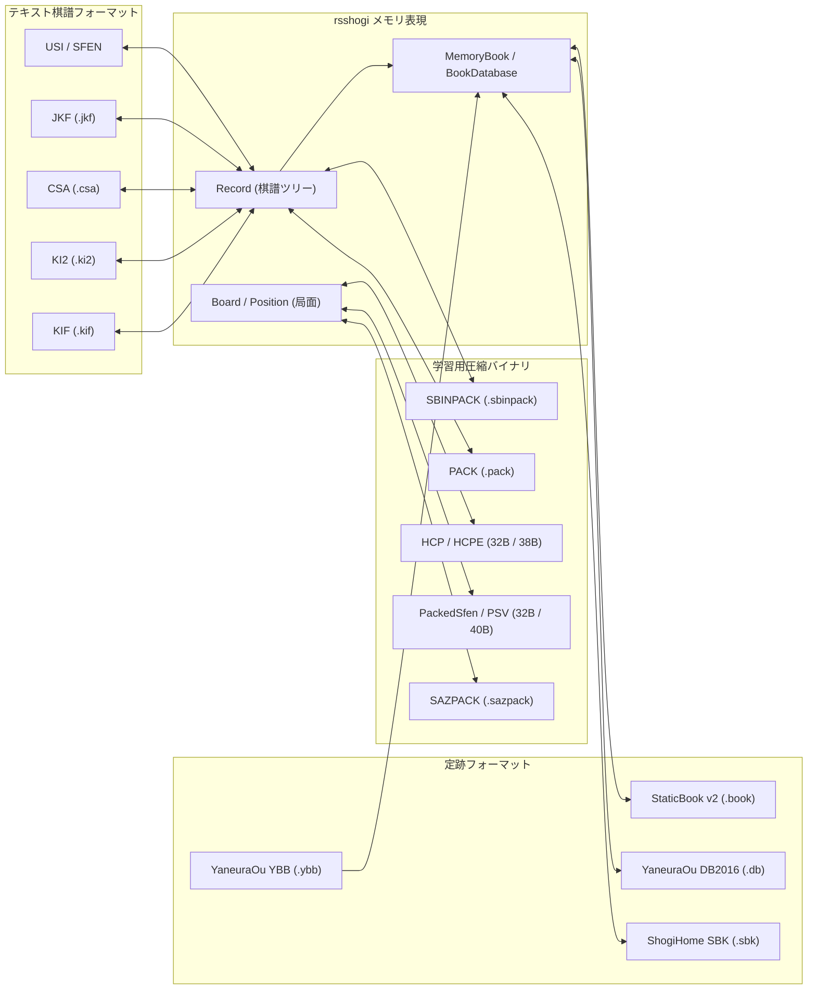

# フォーマット仕様一覧

`rsshogi` は、棋譜（1 局の手順とメタデータ）、定跡（局面から候補手集合への辞書）、および機械学習用の局面と自己対局バイナリまで、用途に応じた複数のデータフォーマットをサポートしている。
本ページでは、各フォーマットの特性比較と相互変換の全体像を示す。

## フォーマット変換ハブ

`rsshogi` におけるデータ構造と外部フォーマットの対応関係を以下の図に示す。



## 1. 棋譜フォーマット（KIF / KI2 / CSA / JKF）

1 局の指し手、消費時間、コメント、対局者情報などを記録するテキストフォーマット群である。
すべて `Record` 型を介して相互に変換できる。

| 項目 | [KIF](kif.md) | [KI2](ki2.md) | [CSA](csa.md) | [JKF](jkf.md) |
| :--- | :--- | :--- | :--- | :--- |
| 主な用途 | 将棋ソフト間の標準交換、観戦記 | 新聞や書籍に近い人間向け表記 | コンピュータ将棋対局、通信プロトコル | Web アプリケーション、プログラム処理 |
| 文字コード | UTF-8 / Shift_JIS | UTF-8 / Shift_JIS | UTF-8 / Shift_JIS | UTF-8（JSON 標準） |
| 指し手表記 | `７六歩(77)`（手数と移動元座標あり） | `▲７六歩`（相対動作表記で移動元省略） | `+7776FU`（移動元、移動先、成後の駒種） | 構造化 JSON オブジェクト |
| 分岐手順（変化） | ○（`変化：N手`） | ○（`変化：N手`） | ✕（仕様上非対応） | ○（`"forks"` 配列） |
| 消費時間の精度 | 秒単位（`MM:SS` / `HH:MM:SS`） | ✕（記録なし） | 秒 / ミリ秒単位（`T12` / V3.0 は `T6.123`） | 秒単位（`time.now` / `time.total`） |
| 指し手コメント | ○（`*コメント`） | ○（`*コメント`） | ○（`'*コメント`） | ○（`"comments"` 配列） |
| 終局行欠落時の挙動 | `main_terminal = None`（`Invalid`） | `SpecialMove::Interrupt`（`Paused`） | `main_terminal = None`（`Invalid`） | `main_terminal = None`（`Invalid`） |

### 棋譜変換の実装例

#### Python

```python
from rsshogi.record import Record

# KIF 文字列をパースして他フォーマットへ変換する
record = Record.from_kif_str(kif_text)
csa_text = record.to_csa()
ki2_text = record.to_ki2()
jkf_text = record.to_jkf()

# Shift_JIS（cp932）で KIF ファイルに書き出す
record.write_kif("game_sjis.kif", encoding="cp932")
```

#### Rust

Rust では `rsshogi` クレートの `records` feature を有効にすることで、各フォーマットの関数を利用できる。
KI2 のパースおよびエクスポート関数は独立した `ki2` サブモジュールではなく、`rsshogi::records::formats::kif` モジュール内で定義され、`rsshogi::records::formats::*` および `rsshogi::records::*` に再エクスポートされている。

```rust
use rsshogi::records::formats::{
    csa::{export_csa, parse_csa_str},
    jkf::{export_jkf, parse_jkf_str},
    kif::{export_ki2, export_kif, parse_ki2_str, parse_kif_str},
};

let record = parse_kif_str(kif_text)?;
let csa_text = export_csa(&record)?;
let ki2_text = export_ki2(&record)?;
let jkf_text = export_jkf(&record)?;
```

## 2. 定跡フォーマット（StaticBook / YaneuraOu / SBK）

局面から候補手、評価値、探索深さ、採択回数（重み）へのマッピングを保持するフォーマット群である。
`rsshogi` の 3 層アーキテクチャと変換規則の詳細は [定跡 3 層アーキテクチャ](book-architecture.md) を参照。

| 項目 | [StaticBook v2](book.md) | [YaneuraOu DB2016](yaneuraou.md) | [YaneuraOu YBB](yaneuraou.md) | [ShogiHome SBK](sbk.md) |
| :--- | :--- | :--- | :--- | :--- |
| 形式 | 独自固定長バイナリ（`.book`） | テキスト（`.db`） | 固定長バイナリ（`.ybb`） | Protobuf バイナリ（`.sbk`） |
| 局面キー | `BookKey`（64/128-bit Zobrist） | 正規化 SFEN 文字列 | 32 バイト `PackedSfen` + `ply` | SFEN + `PackedSfen` 索引 + `state_id` |
| 保持フィールド | `mv`, `score` (`i16`), `depth` (`u16`) | `mv`, `ponder`, `score` (`Option<i32>`), `depth` (`Option<u32>`), `count` (`Option<u64>`), `comment` | `mv`, `eval` (`i16`), `depth` (`Option<u16>`), `ply` (`u16`) | `mv`, `evaluation` (`Option<i32>`), `weight` (`Option<i32>`), `next_state_id`, `evals`, `comment` |
| 読み込み方式 | メモリ常駐 + 二分探索 | ストリーミング走査または二分探索 | メモリ常駐 + `PackedSfen` 二分探索 | `PackedSfen` 二分探索 + オンデマンド Protobuf 復号 |
| 書き出し対応 | ○（`StaticBook::write_file`） | ○（`BookDatabase::write_yaneuraou_db2016`） | ✕（読み取り専用） | ○（`BookDatabase::write_sbk`） |
| Python 対応 | `StaticBook`, `MemoryBook`, `BookBuilder` | `YaneuraOuBook`（読み取り専用） | ✕（Rust のみ） | `SbkBook`（読み取り専用） |

## 3. 学習および圧縮バイナリフォーマット

ニューラルネットワークの学習データ生成、大規模棋譜の高速ストリーム処理、および MCTS 自己対局ログの保存に特化したバイナリフォーマット群である。

| フォーマット | 1 要素のサイズ | 主な用途 | 詳細ページ |
| :--- | :--- | :--- | :--- |
| `HuffmanCodedPos` (HCP) | 32 バイト固定 | Apery / cshogi 互換のハフマン符号化局面 | [学習用バイナリ仕様](training-binaries.md) |
| `HuffmanCodedPosAndEval` (HCPE) | 38 バイト固定 | HCP + 評価値 + 最善手 (`AperyMove`) + 勝敗結果 | [学習用バイナリ仕様](training-binaries.md) |
| `PackedSfen` | 32 バイト固定 | YaneuraOu 互換のビットパック局面 | [学習用バイナリ仕様](training-binaries.md) |
| `PackedSfenValue` (PSV) | 40 バイト固定 | PackedSfen + 評価値 + 指し手 (`Move`) + 手数 + 勝敗 | [学習用バイナリ仕様](training-binaries.md) |
| `PACK` | 可変長（対局単位） | 開始局面 + 手順 (`AperyMove`) と評価値 + 終局結果の連結保存 | [学習用バイナリ仕様](training-binaries.md) |
| `SBINPACK` (`SBN2`) | 可変長（チャンク / チェーン） | 合法手インデックスと評価値差分による高圧縮棋譜ストリーム | [sbinpack フォーマット仕様](../sbinpack.md) |
| `SAZPACK` (`SAZ2` v4) | 可変長（チャンク） | AlphaZero 型 MCTS 自己対局のゲーム統計と疎な方策分布の保存 | [sazpack フォーマット仕様](../sazpack.md) |

## 関連項目

- [Record と棋譜データモデル](../records.md)
- [定跡 3 層アーキテクチャ](book-architecture.md)
- [局面圧縮の仕組み（HCP / PackedSfen）](../../internals/serialization/compression.md)
